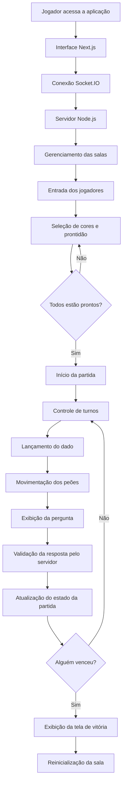
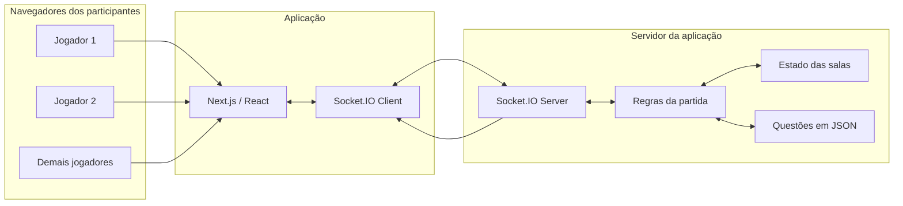

<div align="center">

# 🎲 Brasil Continental

**Jogo de tabuleiro digital multiplayer com perguntas e respostas sobre o Brasil, desenvolvido para proporcionar uma experiência educativa, interativa e competitiva entre jogadores.**

[](https://nextjs.org/)
[](https://react.dev/)
[](https://tailwindcss.com/)
[](https://nodejs.org/)
[](https://socket.io/)

</div>

---

## 📌 Sobre o Projeto

O **Brasil Continental** é um jogo de tabuleiro digital desenvolvido para partidas multiplayer em tempo real. A proposta combina elementos de jogos de tabuleiro tradicionais com perguntas e respostas sobre conhecimentos relacionados ao Brasil.

Os participantes entram em salas de jogo, escolhem suas cores e aguardam o início da partida. Durante o jogo, cada participante lança o dado na sua vez, movimenta seu peão pelo tabuleiro e responde a perguntas para avançar no percurso.

O sistema utiliza comunicação em tempo real para sincronizar as ações dos participantes, permitindo que todos acompanhem a movimentação dos peões, os resultados dos dados e o andamento da partida.

---

## 📑 Sumário

- [✨ Funcionalidades](#-funcionalidades)
- [🏗️ Arquitetura do Sistema](#️-arquitetura-do-sistema-visão-geral)
- [🛠️ Tecnologias Utilizadas](#️-tecnologias-utilizadas)
- [⚙️ Instalação e Execução](#️-instalação-e-execução)
- [📁 Estrutura do Projeto](#-estrutura-do-projeto)
- [📄 Licença](#-licença)
- [👨‍💻 Autor](#-autor)

---

## ✨ Funcionalidades

O sistema disponibiliza os seguintes recursos:

- 🎲 **Tabuleiro digital:** percurso com casas numeradas, início e chegada.
- 👥 **Modo multiplayer:** permite que vários participantes joguem simultaneamente.
- 🏠 **Gerenciamento de salas:** disponibilização de duas salas independentes para partidas.
- 🎨 **Seleção de cores:** cada jogador escolhe uma cor para identificar seu peão.
- ✅ **Sistema de prontidão:** a partida começa quando há pelo menos dois jogadores e todos estão prontos.
- 🎯 **Lançamento de dados:** resultados gerados e controlados pelo servidor.
- 🚶 **Movimentação sincronizada:** animação de deslocamento dos peões casa por casa para todos os participantes.
- 📝 **Questionário interativo:** perguntas com alternativas relacionadas aos conhecimentos sobre o Brasil.
- 🔄 **Gerenciamento de turnos:** controle automático da vez de cada participante.
- 🏆 **Sistema de vitória:** identificação do jogador que alcança a casa final.
- 🔁 **Reinicialização de partidas:** permite iniciar uma nova partida após o encerramento.
- 🔌 **Comunicação em tempo real:** sincronização das informações utilizando Socket.IO.
- 📱 **Interface responsiva:** adaptação da interface para diferentes tamanhos de tela.

---

## 🏗️ Arquitetura do Sistema (Visão Geral)

O projeto foi desenvolvido utilizando o **Next.js com App Router**, integrado a um servidor próprio em Node.js e à biblioteca Socket.IO para implementar a comunicação multiplayer em tempo real.

Diferentemente de uma aplicação baseada exclusivamente em requisições HTTP, o sistema utiliza conexões persistentes para transmitir eventos entre o servidor e os participantes.

O servidor centraliza o gerenciamento das partidas, sendo responsável por validar as ações dos jogadores e manter o estado das salas sincronizado.

### Fluxo geral da partida



### Comunicação entre cliente e servidor



### Responsabilidades do servidor

O servidor é responsável por:

- Controlar a entrada e saída dos participantes.
- Gerenciar a disponibilidade e o estado das salas.
- Validar os lançamentos dos dados.
- Controlar a movimentação dos peões.
- Distribuir as perguntas aos jogadores correspondentes.
- Validar as respostas recebidas.
- Atualizar as posições e os turnos.
- Identificar o vencedor e reinicializar a partida.

Essa abordagem centralizada evita que cada navegador controle individualmente as regras da partida, mantendo a consistência das informações entre os participantes.

---

## 🛠️ Tecnologias Utilizadas

### Frontend

| **Categoria** | **Tecnologia** |
|---|---|
| Framework | Next.js (App Router) |
| Biblioteca | React |
| Linguagem | JavaScript |
| Estilização | Tailwind CSS |
| Navegação | Next.js Navigation |
| Comunicação | Socket.IO Client |

### Backend

| **Categoria** | **Tecnologia** |
|---|---|
| Runtime | Node.js |
| Servidor | Servidor HTTP integrado ao Next.js |
| Comunicação em tempo real | Socket.IO |
| Gerenciamento de partidas | Lógica própria no servidor |
| Armazenamento das perguntas | Arquivo JSON |

### Arquitetura

| **Camada** | **Tecnologia** |
|---|---|
| Interface | Next.js e React |
| Estilização | Tailwind CSS |
| Servidor | Node.js |
| Comunicação cliente-servidor | Socket.IO |
| Estado das partidas | Gerenciamento em memória no servidor |
| Banco de perguntas | JSON |

---

## ⚙️ Instalação e Execução

### 1. Pré-requisitos

Antes de iniciar, é necessário possuir:

- Node.js instalado.
- npm ou outro gerenciador de pacotes compatível.
- Git para clonar o repositório.

### 2. Clonar o repositório

```bash
git clone URL_DO_REPOSITORIO
```

Acesse a pasta do projeto:

```bash
cd NOME_DO_PROJETO
```

### 3. Instalar as dependências

```bash
npm install
```

### 4. Executar a aplicação

Como o projeto utiliza um servidor próprio para integrar Next.js e Socket.IO, execute o script configurado no `package.json` para iniciar o `server.js`.

Por exemplo, caso o script `dev` esteja configurado:

```bash
npm run dev
```

O endereço padrão de acesso local será:

```text
http://localhost:3000
```

### 5. Acesso por outros dispositivos na rede

Para permitir que outros dispositivos conectados à mesma rede local acessem o jogo, o servidor deve escutar na interface de rede apropriada.

Após iniciar o servidor, os participantes poderão acessar utilizando o endereço IP do computador que hospeda a aplicação:

```text
http://IP_DO_SERVIDOR:3000
```

---

## 📁 Estrutura do Projeto

A estrutura abaixo representa a organização geral da aplicação. Ajuste os caminhos caso a organização atual do repositório seja diferente.

```text
brasil-continental/
│
├── public/
│
├── src/
│   ├── app/
│   │   ├── game/
│   │   │   └── page.jsx
│   │   │
│   │   ├── rooms/
│   │   │   └── page.jsx
│   │   │
│   │   ├── globals.css
│   │   ├── layout.jsx
│   │   └── page.jsx
│   │
│   ├── components/
│   │   ├── Board.jsx
│   │   ├── Dado.jsx
│   │   ├── Questionario.jsx
│   │   └── WinModal.jsx
│   │
│   ├── data/
│   │   └── questoes.json
│   │
│   └── lib/
│       └── socket.js
│
├── server.js
├── next.config.mjs
├── package.json
├── postcss.config.mjs
└── README.md
```

### Principais componentes

| **Arquivo** | **Responsabilidade** |
|---|---|
| `server.js` | Inicialização do servidor e gerenciamento das partidas multiplayer. |
| `socket.js` | Configuração e disponibilização da conexão Socket.IO no cliente. |
| `rooms/page.jsx` | Interface de entrada e seleção das salas. |
| `game/page.jsx` | Gerenciamento da interface e dos eventos da partida. |
| `Board.jsx` | Renderização do tabuleiro e dos peões. |
| `Dado.jsx` | Componente visual de lançamento dos dados. |
| `Questionario.jsx` | Exibição das perguntas e alternativas. |
| `WinModal.jsx` | Exibição do resultado final da partida. |
| `questoes.json` | Base de perguntas utilizada durante o jogo. |

---

## 📄 Licença

Este projeto está licenciado sob a licença **MIT**, caso essa seja a licença adotada no repositório.

Consulte o arquivo `LICENSE` para mais informações.

---

## 👨‍💻 Autor

**Silas Santos**

Projeto desenvolvido no contexto de atividades acadêmicas e iniciativas tecnológicas, com foco no desenvolvimento web, interatividade e aplicações multiplayer.

---
